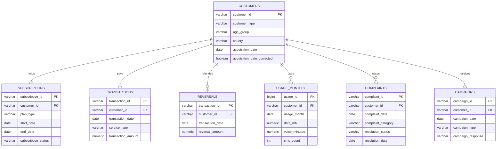
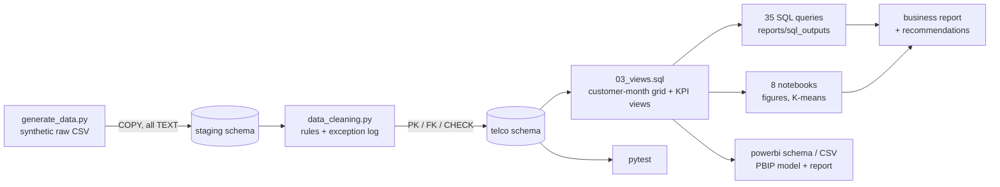
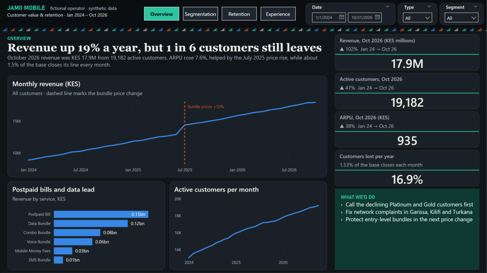
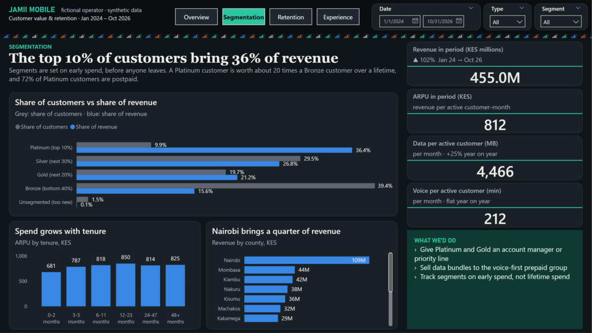
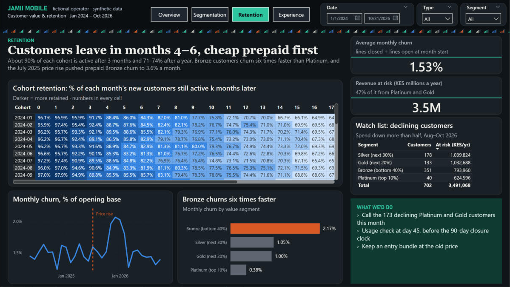
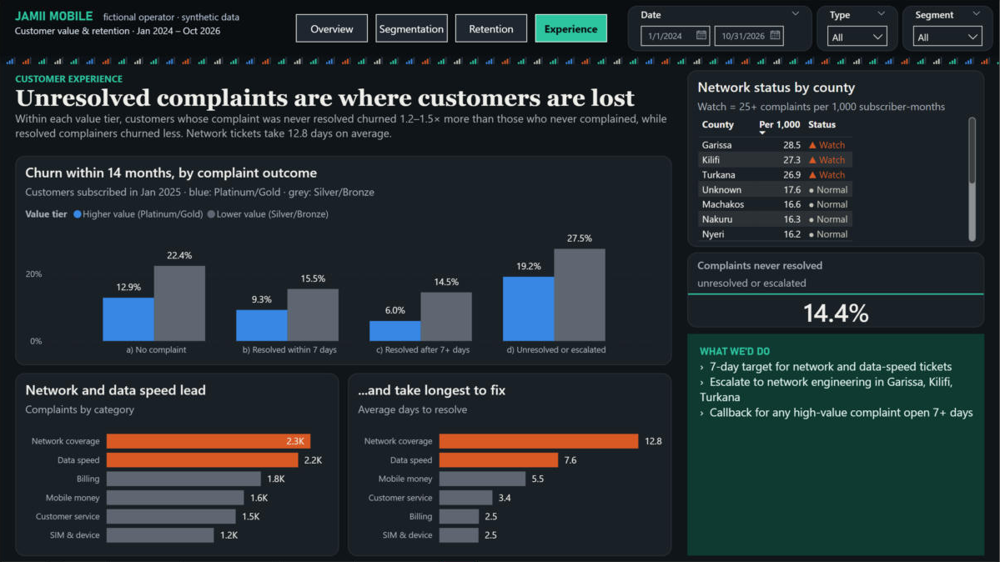
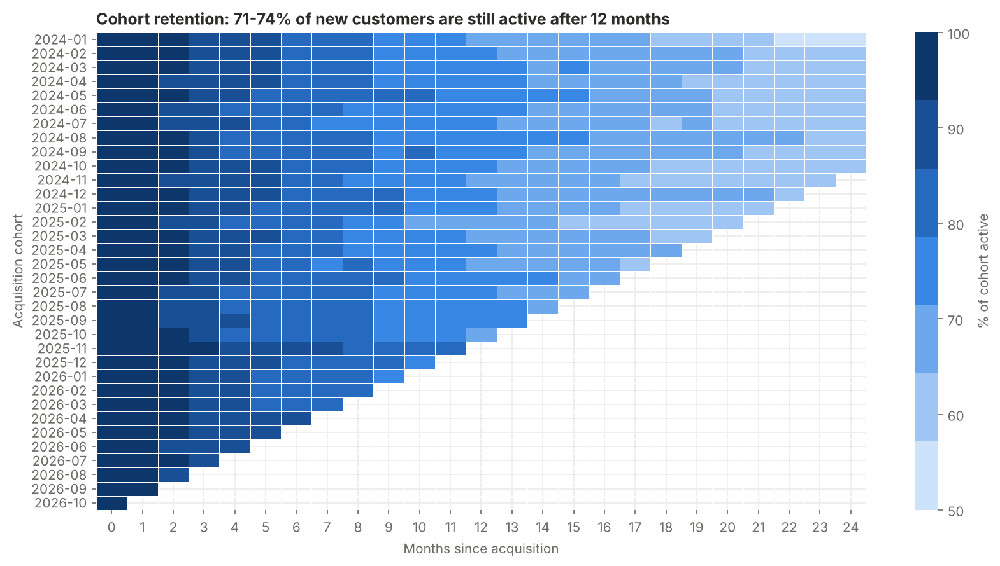
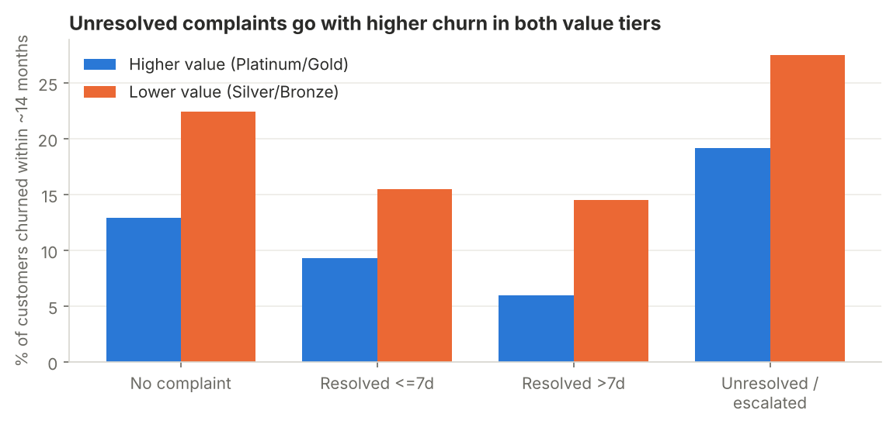

# Telecom Customer Value & Retention Analytics

An end-to-end customer analytics project for **Jamii Mobile**, a fictional Kenyan mobile operator. It runs from raw billing, usage, complaint and campaign extracts to a cleaned PostgreSQL model, 25 business SQL analyses (plus 10 data-quality queries), 8 Python notebooks (including an optional K-means extension), a 4-page Power BI dashboard and a management report.

> **Data disclaimer:** every customer, transaction, usage record, complaint and campaign here is **synthetic**, generated by a documented, reproducible script for a fictional operator. Jamii Mobile does not exist. Nothing describes Safaricom, Airtel Kenya, Telkom Kenya or any other real operator. The findings demonstrate analytical method, not facts about a real business.

**Stack:** PostgreSQL 16 · Python (pandas, NumPy, scikit-learn, Matplotlib, Seaborn, SQLAlchemy) · Jupyter · Power BI / DAX · pytest

This is a **descriptive and diagnostic** project: who creates value, who leaves, when, and what is linked to leaving. It is deliberately **not** a churn-prediction model.

---

## 1. Executive summary
Between January 2024 and October 2026 the subscriber base grew from 13,063 to **19,182 monthly active customers**. October 2026 revenue was **KES 17.9M** (+19.3% year on year) and ARPU was **KES 935** (+7.6%). Behind that growth:

| Question | What the data shows |
|---|---|
| How concentrated is value? | The **top 10% of customers bring 36.4% of revenue**; the bottom 40% bring 15.6%. A Platinum customer is worth roughly **20× a Bronze customer** over their lifetime (simple CLV, KES 79k–115k vs 3.5k–5.1k). |
| How fast do customers leave? | **1.53% of the base closes each month** (about 16.9% a year). Prepaid lines churn at 1.68% a month and postpaid at about 0.5%. Bronze customers churn about 6× faster than Platinum. |
| When do they leave? | About 90% of each cohort is still active after 3 months, about 83% after 6 and **71–74% after 12**. Closures cluster in months 4–6 of tenure. |
| What is linked to leaving? | Customers whose complaint was **never resolved or was escalated churned 1.2–1.5× more** than customers who never complained, within the same value tier. Customers whose complaint was resolved churned *less*. |
| Where is the service problem? | **Network coverage** complaints take 12.8 days to resolve on average and 29.8% are never resolved. **Garissa, Kilifi and Turkana** raise about 1.8× the complaint rate of other counties and have the highest churn (about 2% a month). |
| Did the July 2025 price rise cost customers? | Prepaid Bronze churn rose from **2.37% to 3.62% a month** in the four months after it, then settled at 2.15%. Higher-value and postpaid customers barely moved. |
| Who is about to leave? | **702 customers** are declining (revenue down more than 50% between May–Jul and Aug–Oct 2026). Their decline has already cost **KES 3.5M a year** at run rate, **47%** of it from Platinum and Gold customers. |

## 2. Business problem
Jamii Mobile's subscriber numbers are growing, but the commercial team does not know which customers create the value, why some customers become inactive and leave, whether complaints are behind it, or which customers to protect first. The brief: *describe customer value and retention, diagnose what is linked to churn, and recommend where to act.*

## 3. Kenyan industry context
Kenya's market is overwhelmingly **prepaid**: customers buy data, voice, SMS and combo bundles as they need them, and many also pay mobile-money transaction fees. The Communications Authority of Kenya reported about 88 million active mobile subscriptions by June 2026 ([CA sector statistics](https://www.ca.go.ke/node/270)), more than one per adult, because many people hold several SIMs. That makes **inactivity**, not a cancellation request, the usual way a prepaid customer leaves, and it is why this project defines churn through a 90-day inactivity rule. Network coverage outside the big towns, price changes and bundle competition are the familiar retention pressures. The simulation reflects these features; the CA figure is real context, never mixed into the synthetic data.

## 4. Business objectives
1. Measure the base: active customers, revenue, ARPU, usage and growth by month, plan, county and age group.
2. Identify which customers create value (value segments, tenure, CLV range), and test whether data-driven clusters agree.
3. Measure churn and retention correctly: monthly churn rate, cohort retention curves, early-life churn.
4. Diagnose what is linked to churn: complaints, resolution time, coverage, price changes, campaigns.
5. Name the customers to contact first, and give management a short, prioritised and measurable action list.

The business questions are mapped to queries in [`reports/sql_query_guide.md`](reports/sql_query_guide.md).

## 5. Dataset source
I reviewed the **IBM Telco Customer Churn** sample (a fictional California operator: 7,043 customers in a single snapshot, no published licence), Communications Authority of Kenya statistics and other public telecom samples. None has monthly history per customer, usage, complaints or campaigns for a prepaid market, so cohort and declining-activity analysis would be impossible. I wrote [`src/generate_data.py`](src/generate_data.py) (seed 2027) instead. It simulates the business month by month from January 2024 to October 2026:

| Table | Rows (clean) | Grain |
|---|---|---|
| customers | 28,496 | subscriber (13,000 at the start + about 430 acquisitions a month) |
| subscriptions | 31,539 | plan period (plan changes create a new row) |
| transactions | 1,767,028 | bundle purchase, mobile-money fee or postpaid bill |
| reversals | 3,533 | reversed transaction |
| usage_monthly | 560,429 | customer × month (data MB, voice minutes, SMS) |
| complaints | 10,559 | complaint ticket |
| campaigns | 35,523 | campaign contact (upsell, data bonus, loyalty, win-back) |

Churn emerges from a hazard process (tenure, plan type, unresolved and slow complaints, poor-coverage counties, a July 2025 price change, accepted win-back offers). Churning customers first **decline**, then go **silent**, and the line closes after 90 days of inactivity, as a real prepaid line would. Hidden behavioural archetypes drive usage but are **never** given to the analysis; they are only used afterwards to check the clustering. Controlled data-quality defects are injected and recorded in a manifest, so cleaning can be verified.

## 6. Data limitations
Synthetic data (method, not real-world evidence) · usage is monthly, so within-month behaviour is invisible · revenue is billed revenue, not margin (CLV uses an assumed 45–65% margin range) · no competitor, network-quality or handset data · complaint–churn and campaign results are associations from observational data, not causal effects · 3% of customers have no county.

## 7. Technology stack
| Layer | Tools |
|---|---|
| Storage & modelling | PostgreSQL 16 (all-TEXT `staging` + constrained `telco` schema + semantic views + materialized customer-month grid) |
| Processing & analysis | Python 3.13, pandas, NumPy, scikit-learn, SQLAlchemy, psycopg2 |
| Visualisation | Matplotlib, Seaborn, Power BI (TMDL/PBIR project, DAX) |
| Quality | pytest (33 tests), SQL integrity checks, exception log, KPI reconciliation |

## 8. Database architecture





Design choices: raw data lands in an all-TEXT `staging` schema so bad values can be profiled instead of crashing the load. The `telco` schema enforces keys and business rules (`CHECK ((subscription_status = 'Active') = (end_date IS NULL))`, `UNIQUE (customer_id, usage_month)`). Reversals get their own table instead of being netted against revenue. The heart of the model is a materialized **customer-month grid** (`telco.mv_customer_month`): one row per customer for every month they were subscribed, with revenue, usage, `is_active`, `in_opening_base` and `is_churn_month`. Every retention metric reads from it, so SQL, Python and Power BI use the same denominators.

## 9. Analytical methodology
Profile → clean (fix only what is certain, quarantine what would be a guess, log everything) → validate → **define metrics once** → analyse with SQL → investigate with Python → communicate. The definitions that matter most:

| Metric | Definition |
|---|---|
| Active customer (month) | at least one paid transaction or recorded usage in the month |
| Monthly churn rate | lines closed in the month ÷ lines open on day 1 of the month (opening base) |
| ARPU | revenue in the month ÷ active customers in the month |
| Cohort retention (c, k) | cohort *c* customers active in month *c + k* ÷ cohort size (fixed denominator); cells after Oct 2026 are blank, not 0 |
| Value segment | decile of **early** monthly revenue (first 3 months, or Jan–Mar 2024 for the opening base): Platinum top 10%, Gold next 20%, Silver next 30%, Bronze bottom 40% |
| Declining customer | revenue fell more than 50% from May–Jul to Aug–Oct 2026, or no activity at all in Aug–Oct |

Value segments use **early** spend on purpose: segmenting on lifetime average spend would make churners look low-value simply because they spent nothing while leaving, which is reverse causality. Full details: [`reports/methodology.md`](reports/methodology.md).

## 10. SQL analysis
35 named queries in `sql/`, organised by purpose: `02_data_quality_checks` (10), `04_customer_value` (7), `05_retention` (8), `06_customer_experience` (5), `07_strategy` (5). They use joins, CTEs, `CASE WHEN`, conditional aggregation (`FILTER`), window functions (`NTILE`, `RANK`, `LAG`, moving averages), `GROUPING SETS`/`ROLLUP`, `generate_series` and date logic. `python -m src.run_sql` executes everything and saves each result to `reports/sql_outputs/`. Each query's purpose and result are explained in the [SQL query guide](reports/sql_query_guide.md).

## 11. Python analysis
| Notebook | Content |
|---|---|
| [01_customer_data_understanding](notebooks/01_customer_data_understanding.ipynb) | grain, coverage, one customer traced end to end, metric definitions |
| [02_data_quality_and_cleaning](notebooks/02_data_quality_and_cleaning.ipynb) | profiling, rules, exception log, manifest cross-check |
| [03_customer_exploration](notebooks/03_customer_exploration.ipynb) | base by type, plan, county, age; spend distribution and value concentration |
| [04_revenue_and_usage_analysis](notebooks/04_revenue_and_usage_analysis.ipynb) | revenue and ARPU trends, service mix, usage growth, ARPU by tenure |
| [05_cohort_and_retention_analysis](notebooks/05_cohort_and_retention_analysis.ipynb) | churn trend, churn by segment and tenure, cohort heatmap (SQL and pandas agree) |
| [06_customer_segmentation](notebooks/06_customer_segmentation.ipynb) | value segments, simple CLV range, **optional K-means** compared with the value segments |
| [07_customer_experience_analysis](notebooks/07_customer_experience_analysis.ipynb) | complaint mix, resolution time, county pattern, complaint–churn link stratified by value |
| [08_business_recommendations](notebooks/08_business_recommendations.ipynb) | campaigns, win-back, price change, at-risk list, opportunity sizing |

Reusable code is in `src/`: `data_loader.py` (env-var connection, COPY loader), `data_cleaning.py` (rules), `analysis.py` (metric functions, retention matrix, CLV, chart style), `pipeline.py`, `run_sql.py`, `export_powerbi.py`.

**K-means extension.** Five standardised behaviour features (log revenue, data, voice, SMS, purchases per month) for 25,711 customers with at least 4 active months. *k* = 4 was chosen as the best silhouette score between 3 and 6 (*k* = 2 scored higher but only separated postpaid business users from everyone else). The clusters are *Business postpaid*, *Data-heavy prepaid*, *Voice-first prepaid* and *Light / occasional*. They describe **how** customers use the network, while the value segments describe **how much** they spend, so the two are complementary: 99.7% of Light / occasional customers are Bronze, but Voice-first customers are spread across Bronze and Silver. Because the data is synthetic, I could check the clusters against the generator's hidden archetypes: adjusted Rand index 0.64.

## 12. Power BI dashboard
Built as a **Power BI project** ([`powerbi/JamiiMobile.pbip`](powerbi/)): the TMDL semantic model and PBIR report are text files generated by `scripts/build_pbip.py`, then loaded and refreshed in Power BI Desktop. The model has 8 imported tables (a marked date table, a customer dimension, four facts and two pre-aggregated tables for the cohort heatmap and the complaint–churn link), 8 single-direction relationships and 44 DAX measures. A DAX query run in Power BI returned the KPI values in `powerbi/kpi_reconciliation.csv`. Each page is laid out editorially, with a headline that states the finding, one hero chart and a "What we'd do" box, on a dark control-room theme with a colour-blind-safe blue/orange palette. Model specification, measures, design and validation: [`powerbi/README.md`](powerbi/README.md).

Four pages, each answering one question, with shared date, customer type and value-segment slicers in the masthead:






## 13. Key findings (from the analysis)
1. **Growth:** monthly active customers +10.8% and revenue +19.3% year on year to October 2026. ARPU rose 7.6%, helped by the July 2025 price change and by data use per customer (+25% year on year).
2. **Revenue mix:** postpaid bills are 33.6% of revenue from about 12% of customers; data bundles are the largest prepaid line (26.3%).
3. **Value concentration:** the top 10% of customers bring 36.4% of revenue. 72% of Platinum customers are postpaid.
4. **Churn:** 1.53% a month (16.9% a year), implying an average lifetime of about 65 months. Prepaid Flex is the highest-churn plan (1.86%); Bronze 2.42% vs Platinum 0.41%; 18–24-year-olds churn most (1.73%).
5. **Early life:** closures concentrate in tenure months 4–6 (about 3.5% a month) because the 90-day rule closes the lines of customers who stopped using them in their first months.
6. **Cohorts:** retention after 12 months is stable at 71–74% across 2024–2025 cohorts; the 2025-Q3 cohort, acquired around the price change, is the weakest at 3 months (88.2%).
7. **Complaints:** network coverage and data speed make up 43% of complaints and are by far the slowest to resolve. Within each value tier, unresolved or escalated complaints are linked with 1.2–1.5× the churn of non-complainers.
8. **Coverage counties:** Garissa, Kilifi and Turkana have complaint rates of 27–29 per 1,000 subscriber-months (about 16 elsewhere) and the highest churn.
9. **Price change:** prepaid Bronze churn jumped to 3.62% in Nov 2025–Feb 2026 and recovered to 2.15%; the effect was concentrated among low-value prepaid customers.
10. **At risk now:** 702 declining customers, KES 3.5M a year already lost at run rate, 47% from Platinum/Gold. A ranked contact list is in `q23_valuable_customers_at_risk.csv`.




## 14. Business recommendations
1. **Call the 173 declining Platinum and Gold customers first** (account manager for postpaid, outbound retention call for prepaid), using the ranked list.
2. **Fix network-complaint handling:** a 7-day target for coverage and data-speed tickets, and an escalation path to network engineering in Garissa, Kilifi and Turkana.
3. **Treat an unresolved complaint as a churn signal:** flag open complaints older than 7 days on high-value customers for a retention callback.
4. **Run an early-life programme for months 1–3:** onboarding bundles and a usage check at day 45, before the 90-day closure clock runs out.
5. **Protect low-value prepaid customers in future price changes:** keep an entry-level bundle at the old price point and test any change on a region first.
6. **Measure win-back properly:** the 1.7% vs 93.7% closure gap is self-selected; run the next win-back campaign with a random hold-out group.

Owners, evidence and success measures: [`reports/recommendations.md`](reports/recommendations.md). Full write-up: [`reports/business_report.md`](reports/business_report.md).

## 15. Limitations
See §6. The most important: findings come from simulated data, and the complaint, price-change and campaign results are associations, not causal measurements. In particular, the win-back comparison compares people who chose to accept an offer with people who did not.

## 16. Future improvements
- A churn-prediction model (gradient boosting with time-based validation), built on top of the definitions here, with the at-risk list as its baseline to beat.
- A randomised hold-out for win-back and upsell campaigns, to measure incremental retention.
- Network-quality data (dropped calls, site outages) joined by county to test the coverage explanation directly.
- Scheduled refresh and a Power BI service deployment with row-level security by region.

## 17. What I learned
- **A churn rate is only as good as its denominator.** Dividing churners by *all* customers in the month, or by customers at the end of the month, gives different answers. I fixed the definition (opening base) in one SQL view and built everything from a customer-month grid, so the dashboard cannot drift from the notebooks.
- **Segmenting on lifetime spend is circular.** My first value segments used average monthly revenue over the whole period. Churners spend nothing in their last months, so "Bronze churns most" was partly true by construction. Re-defining segments on early spend removed the reverse causality.
- **A raw comparison can hide a confounder.** Complainers looked *less* likely to churn than non-complainers, because high-value customers complain more and churn less. Stratifying by value tier showed the real pattern: resolved complaints are fine, unresolved ones are linked to churn.
- **One outlier rule is not enough.** A single KES 25,000 ceiling caught big keying errors on bundles but let three ×1000 mobile-money fees through (a KES 13 fee became 13,000). Profiling each service's own range caught them.
- **Clustering needs a business check, not just a score.** The silhouette score preferred *k* = 2, which was useless for marketing. I constrained *k* to 3–6 and compared the clusters with the value segments to see what they added.
- **Self-selection looks like success.** Customers who accepted a win-back offer almost never left, but they chose to accept. The honest recommendation is a hold-out test, not a bigger campaign.

## 18. Reproduction
Requirements: Python 3.10+, PostgreSQL 14+ (tested on 16), Power BI Desktop (for the dashboard).

```bash
git clone https://github.com/M-Linet/telecom-customer-value-analytics.git
cd telecom-customer-value-analytics
python -m venv .venv && .venv\Scripts\activate        # Windows  (macOS/Linux: source .venv/bin/activate)
pip install -r requirements.txt
copy .env.example .env                                 # then set PGPASSWORD (macOS/Linux: cp)
python scripts/run_all.py                              # data → DB → SQL → notebooks → Power BI extract + project → tests
```
Step by step: `python -m src.generate_data` → `python -m src.pipeline` → `python -m src.run_sql` → `python scripts/build_notebooks.py` → `python -m src.export_powerbi` → `python scripts/build_pbip.py` → `pytest`. Then open `powerbi/JamiiMobile.pbip` in Power BI Desktop and click **Refresh**.

The generated data (about 220 MB of CSV) is git-ignored and rebuilt deterministically from the seed.

---
*Interview preparation for this project: [`reports/interview_questions.md`](reports/interview_questions.md).*
