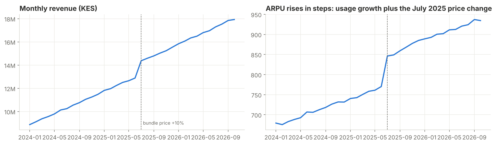
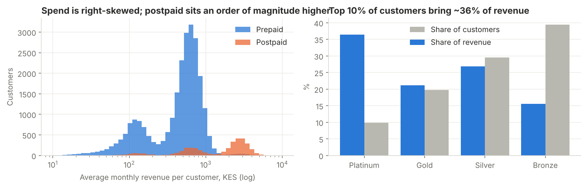
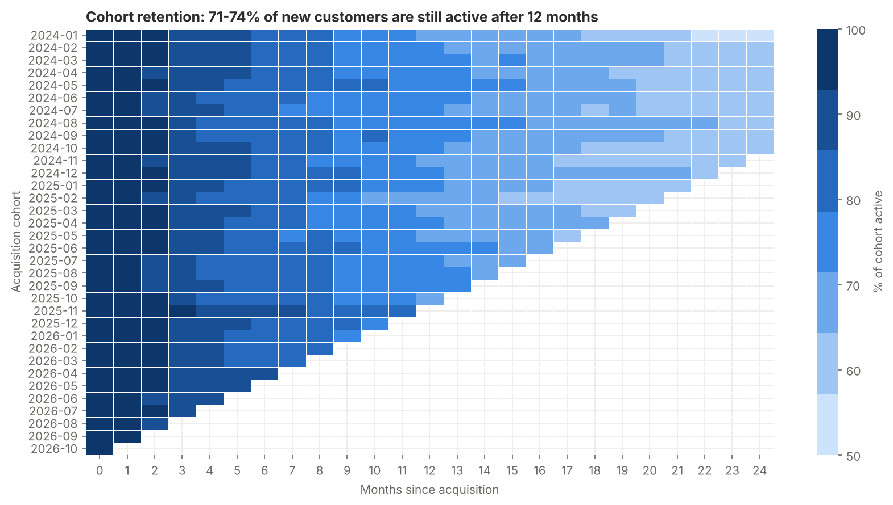
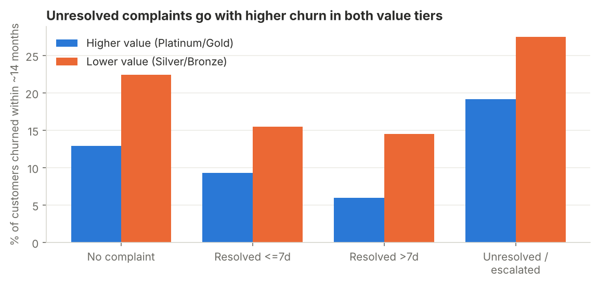

# Jamii Mobile: customer value and retention review
*Prepared for the Commercial Director · data to 31 October 2026 · all data synthetic, fictional operator*

## 1. Summary
Jamii Mobile ended October 2026 with **19,182 active customers** (+10.8% year on year), **KES 17.9M** of monthly revenue (+19.3%) and an ARPU of **KES 935** (+7.6%). Growth is healthy, but value is concentrated and leakage is measurable:

- **Value is concentrated.** The top 10% of customers bring 36.4% of revenue. Losing one Platinum customer costs about as much lifetime value as losing twenty Bronze customers.
- **About 1 in 6 customers leaves each year.** Average monthly churn is 1.53% (16.9% annualised). Prepaid churns about three times faster than postpaid.
- **Unresolved complaints are the clearest warning sign.** Within the same value tier, customers whose complaint was never resolved or was escalated churned 1.2–1.5× more than customers who never complained. Customers whose complaint *was* resolved churned less.
- **Network complaints are slow, and concentrated in three counties.** Coverage tickets take 12.8 days on average and 30% are never resolved. Garissa, Kilifi and Turkana raise about 1.8× the complaint rate of other counties and have the highest churn.
- **The July 2025 price change cost low-value prepaid customers.** Their churn rose from 2.37% to 3.62% a month for four months, then recovered.
- **702 customers are declining right now**, KES 3.5M a year already lost at run rate. 173 of them are Platinum or Gold.

## 2. The customer base
| | Oct 2025 | Oct 2026 | Change |
|---|---|---|---|
| Active customers | 17,312 | 19,182 | +10.8% |
| Monthly revenue (KES) | 15.0M | 17.9M | +19.3% |
| ARPU (KES) | 868 | 935 | +7.6% |

Postpaid bills are 33.6% of revenue from 12% of customers. Among prepaid services, data bundles (26.3% of revenue) and combo bundles (16.5%) lead; data use per active customer grew 25% year on year while voice was flat (−2%). Nairobi accounts for 24% of revenue. Customers aged 35–44 have the highest ARPU (KES 946) and 18–24-year-olds the lowest among under-55s (KES 682).

## 3. Who creates value
Customers are segmented by **early** monthly spend (their first three months), so that the segment is fixed before any decision to leave:

| Segment | Share of customers | Share of revenue | Average monthly revenue (KES) | Monthly churn | Simple CLV (KES, 45–65% margin) |
|---|---|---|---|---|---|
| Platinum (top 10%) | 9.9% | 36.4% | 2,464 | 0.41% | 79k – 115k |
| Gold (next 20%) | 19.7% | 21.2% | 797 | 1.09% | 17k – 25k |
| Silver (next 30%) | 29.5% | 26.8% | 596 | 1.15% | 13k – 18k |
| Bronze (bottom 40%) | 39.4% | 15.6% | 264 | 2.42% | 3.5k – 5.1k |

72% of Platinum customers are postpaid. An optional K-means analysis of usage behaviour found four groups (*Business postpaid*, *Data-heavy prepaid*, *Voice-first prepaid*, *Light / occasional*). They agree with the value segments at the extremes (almost all Light / occasional customers are Bronze) and add a behavioural dimension in the middle: Data-heavy and Voice-first customers spend similar amounts but need different offers.

## 4. Who leaves, and when
| Group | Monthly churn |
|---|---|
| All customers (May 2024 – Oct 2026) | 1.53% |
| Prepaid / Postpaid | 1.68% / 0.55% |
| Prepaid Flex (highest plan) / Postpaid Business (lowest) | 1.86% / 0.36% |
| Age 18–24 (highest) / 35–44 (lowest) | 1.73% / 1.41% |
| Garissa, Kilifi, Turkana | 1.96–2.03% |

**Early life is the riskiest period.** Lines close after 90 days without activity, so the first closures appear in tenure month 4, and months 4–6 have the highest closure rates (about 3.5% a month). These are customers who stopped using the line in their first weeks. It falls to about 1.7% in the second year and settles near 1.1% after two years.

**Cohorts are stable.** About 97% of each acquisition cohort is active after one month, about 90% after three, about 83% after six and 71–74% after twelve. The weakest three-month result (88.2%) belongs to the 2025-Q3 cohort, acquired around the price change.

## 5. What is linked to leaving
**Complaints.** Among customers subscribed on 1 January 2025, churn over the following 14 months by their worst complaint outcome in January–June 2025:

| | No complaint | Resolved within 7 days | Resolved after 7+ days | Unresolved or escalated |
|---|---|---|---|---|
| Platinum / Gold | 12.9% | 9.3% | 6.0% | **19.2%** |
| Silver / Bronze | 22.4% | 15.5% | 14.5% | **27.5%** |

Comparing within tiers matters: higher-value customers complain more and churn less, so an unstratified comparison hides the effect. A resolved complaint is not a problem; an unresolved one is. This is an association: unhappy customers may both complain and leave for other reasons.

**Network quality.** Network coverage (22% of complaints) and data speed (21%) are the most common and by far the slowest categories: coverage tickets average 12.8 days (90th percentile 27 days) and 29.8% are never resolved, against 2.5 days and 6.5% for billing. Garissa, Kilifi and Turkana generate 27–29 complaints per 1,000 subscriber-months against about 16 elsewhere; almost all of the difference is network and data-speed tickets (about 15 per 1,000 against 6).

**Price.** After bundle prices rose about 10% in July 2025, prepaid Bronze churn rose from 2.37% (Mar–Oct 2025) to 3.62% (Nov 2025–Feb 2026), allowing for the four-month closure lag, then fell back to 2.15%. Prepaid Silver rose less (1.13% → 1.42%), and Platinum, Gold and postpaid customers did not react.

## 6. Campaigns
| Campaign | Contacts | Accepted |
|---|---|---|
| Loyalty points | 7,098 | 34.4% |
| Win-back offer | 7,601 | 29.5% |
| Data bonus | 11,007 | 24.0% |
| Bundle upsell | 9,817 | 11.8% |

Customers who accepted a win-back offer almost never closed their line in the next six months (1.7%, against 93.7% of those who did not accept). That gap is **not** the effect of the offer: the customers who accept are the ones still willing to stay. The next win-back campaign needs a random hold-out group to measure what it actually saves.

## 7. Customers at risk now
702 current customers have cut spending by more than half between May–Jul and Aug–Oct 2026 (or stopped entirely). Their decline has already removed about **KES 3.5M a year** of revenue at run rate; **KES 1.7M (47%)** of that is from 173 Platinum and Gold customers. The ranked contact list is `sql_outputs/q23_valuable_customers_at_risk.csv`. Set against run-rate annual revenue of KES 215M, this is about 1.6%, which is the scale of what an early-warning process can protect each quarter.

## 8. Recommendations
See [`recommendations.md`](recommendations.md) for owners and success measures.
1. Contact the 173 declining Platinum and Gold customers this month.
2. Set a 7-day target for network and data-speed complaints, with escalation to network engineering in Garissa, Kilifi and Turkana.
3. Treat any high-value complaint open more than 7 days as a retention case.
4. Run an early-life programme in months 1–3, before the 90-day closure clock runs out.
5. Keep an entry-level bundle at the old price point in future price changes, and pilot changes regionally.
6. Run the next win-back campaign with a random hold-out group.

## 9. Caveats
The data is synthetic: these findings show how the analysis works, not facts about a real operator. Complaint, price and campaign results are associations, not proven causes. Usage is monthly, so within-month behaviour is not visible. CLV uses an assumed margin range because cost data is not available.
